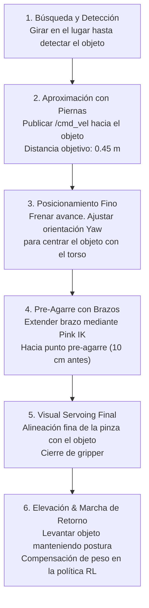

# Plan Maestro: Loco-Manipulación de Cuerpo Completo y Visión Estéreo para Berkeley Humanoid Lite

Este documento detalla la hoja de ruta técnica paso a paso para dotar al **Berkeley Humanoid Lite (BHL)** de:
1. **Movimiento natural y coordinado de cuerpo completo:** Capacidad de mover brazos y piernas en simultáneo sin perder el balance dinámico.
2. **Percepción estéreo 3D:** Detección y localización precisa de objetos en el espacio tridimensional y compensación de vibraciones del torso.
3. **Bucle cerrado visión-control (Visual Servoing):** Retroalimentación continua para aproximación, alineación y agarre de precisión (*Grasping*).

---

## 1. Arquitectura del Sistema (Jerarquía de Control)

Para que el robot no se caiga cuando estira un brazo o levanta un objeto, la arquitectura divide las responsabilidades en capas especializadas:

```
┌────────────────────────────────────────────────────────────────────────┐
│                      CAPA 4: PERCEPCIÓN ESTÉREO 3D                     │
│  - Cámara RGB-D + IMU (30 Hz)                                          │
│  - Detección 2D (YOLOv11) + Filtro de Profundidad 3D                   │
│  - Estimación de Pose 6D del Objeto (X, Y, Z, Roll, Pitch, Yaw)        │
│  - Filtro Kalman Extendido (EKF) para amortiguar vibraciones de marcha │
└───────────────────────────────────┬────────────────────────────────────┘
                                    │ Pose del objetivo respecto a base_link
                                    ▼
┌────────────────────────────────────────────────────────────────────────┐
│                   CAPA 3: COORDINADOR DE TAREAS & IK                   │
│  - Máquina de Estados / Behavior Tree                                  │
│  - Planificador de Manos (Pink + Pinocchio Whole-Body IK a 50 Hz)      │
│  - Generación de comandos de marcha: /cmd_vel hacia el objetivo        │
└───────────────────┬────────────────────────────────┬───────────────────┘
                    │                                │
    Comando marcha  │                                │ Ángulos objetivo brazos
    (Vx, Vy, Vyaw)  │                                │ (q_brazos_deseado)
                    ▼                                ▼
┌────────────────────────────────────────────────────────────────────────┐
│             CAPA 2: POLÍTICA DE LOCOMOCIÓN ROBUSTA (RL)                │
│  - Red Neuronal ONNX en Isaac Sim / MuJoCo (25 - 50 Hz)                │
│  - Observa: IMU, velocidades articulares, postura deseada de brazos   │
│  - Entrenada con perturbaciones severas de masa en efectores finales   │
│  - Genera: Ángulos objetivo de piernas (12 articulaciones)             │
└───────────────────────────────────┬────────────────────────────────────┘
                                    │ Ángulos objetivo totales (22 DOFs)
                                    ▼
┌────────────────────────────────────────────────────────────────────────┐
│                   CAPA 1: CONTROLADOR PD & HARDWARE                    │
│  - 250 - 500 Hz (C++ / CAN Bus / Recoil Drivers)                       │
│  - Torque = Kp · (q_des - q) - Kd · q_dot (Límites de esfuerzo)        │
└────────────────────────────────────────────────────────────────────────┘
```

---

## 2. Hoja de Ruta Paso a Paso

### Fase 1: Preparación del Modelo y Espacio Cinemático
> **Objetivo:** Disponer del modelo cinemático completo con límites articulares, masas y transformadas de cámara.

1. **Definir el marco de la cámara estéreo en el URDF:**
   * En [`berkeley_humanoid_lite.urdf`](file:///Users/brandonperez/Proyectos/Robotica/Humanoid/berkeley-humanoid-lite/source/berkeley_humanoid_lite_assets/data/urdf/berkeley_humanoid_lite.urdf), agregar el eslabón `camera_link` y su junta fija al torso o cabeza:
     * Traslación fija: `[0.08, 0.0, 0.35]` (frente y parte superior del torso).
     * Inclinación hacia abajo (*pitch* de ~15° a 25°) para enfocar tanto el suelo próximo como mesas frente al robot.
2. **Definir los Efectores Finales (*End-Effectors*):**
   * Configurar los marcos de referencia de agarre en las muñecas/pinzas: `left_gripper_palm_link` y `right_gripper_palm_link`.
3. **Validación de Espacio de Trabajo con Pinocchio:**
   * Verificar en [`scripts/teleop/test_solver.py`](file:///Users/brandonperez/Proyectos/Robotica/Humanoid/berkeley-humanoid-lite/scripts/teleop/test_solver.py) que el solver de Pink alcanza el rango frontal útil (de 0.25 m a 0.55 m adelante del torso) sin singularidades ni colisiones entre codos y torso.

---

### Fase 2: Re-entrenamiento de la Política de RL (Locomoción Condicionada)
> **Objetivo:** Lograr que las piernas compensen automáticamente el desplazamiento del Centro de Masa (CoM) y la inercia cuando los brazos se mueven o cargan peso.

1. **Aumento del Espacio de Observación de la Política:**
   * Modificar [`source/berkeley_humanoid_lite/berkeley_humanoid_lite/tasks/locomotion/velocity/config/humanoid/env_cfg.py`](file:///Users/brandonperez/Proyectos/Robotica/Humanoid/berkeley-humanoid-lite/source/berkeley_humanoid_lite/berkeley_humanoid_lite/tasks/locomotion/velocity/config/humanoid/env_cfg.py) para que la red reciba:
     * $q_{\text{brazos}}$ y $\dot{q}_{\text{brazos}}$ actuales.
     * $q_{\text{brazos\_target}}$ deseados (información anticipatoria del movimiento).
2. **Estrategia de Aleatorización de Dominio (*Domain Randomization*):**
   * **Movimiento aleatorio de brazos durante el entrenamiento:** En cada episodio en Isaac Lab, mover los brazos por trayectorias senoidales o aleatorias continuas para que las piernas aprendan que los brazos no están quietos.
   * **Carga en las manos (*Payload Randomization*):** Añadir masas aleatorias entre $0.0\text{ kg}$ y $1.5\text{ kg}$ a las manos durante el entrenamiento.
   * **Empujones en el torso (*Torso Disturbances*):** Aplicar impulsos de fuerza horizontal aleatorios de $10\text{ N}$ a $25\text{ N}$ cada 5 a 8 segundos.
3. **Funciones de Recompensa para Movimiento Natural:**
   * **Penalización de torsión en el tronco:** Recompensar que el ángulo de *Roll* y *Pitch* del torso permanezca cercano a cero:
     $$\text{Reward}_{\text{torso\_ori}} = \exp\left(-\frac{\|\theta_{\text{pitch}}\|^2 + \|\theta_{\text{roll}}\|^2}{\sigma^2}\right)$$
   * **Regularización de consumo energético y cambios bruscos de aceleración articular (*Smoothness*):**
     $$\text{Penalty}_{\text{jerk}} = -\|\ddot{q}_{t} - \ddot{q}_{t-1}\|^2$$
4. **Exportar y Validar en MuJoCo:**
   * Exportar el checkpoint entrenado como `policy_humanoid_locomanip.onnx`.
   * Probar en [`scripts/sim2sim/play_mujoco.py`](file:///Users/brandonperez/Proyectos/Robotica/Humanoid/berkeley-humanoid-lite/scripts/sim2sim/play_mujoco.py) forzando los brazos a extenderse hacia adelante mientras el robot camina.

---

### Fase 3: Pipeline de Visión Estéreo 3D y Estimación de Pose
> **Objetivo:** Detectar entidades en el entorno, calcular su posición espacial milimétrica y filtrar las oscilaciones causadas por la marcha.

1. **Integrar la Cámara Estéreo en la Simulación:**
   * En [`bhl_scene.xml`](file:///Users/brandonperez/Proyectos/Robotica/Humanoid/berkeley-humanoid-lite/source/berkeley_humanoid_lite_assets/data/mjcf/bhl_scene.xml), añadir el sensor de cámara RGB-D:
     ```xml
     <camera name="stereo_cam" pos="0.08 0 0.35" euler="0 15 0" fovy="60"/>
     ```
   * En hardware real: Usar una cámara estéreo con obturador global (*Global Shutter*) y filtro IR activo (ej. Intel RealSense D435i/D455 o Luxonis OAK-D Pro).
2. **Detección y Estimación de Profundidad 3D:**
   * **Paso A:** Inferencia de detección de objetos con YOLOv11 o Grounding-DINO sobre la imagen RGB a 30 FPS.
   * **Paso B:** A partir del cuadro delimitador (*bounding box*) o máscara de segmentación, consultar la matriz de profundidad alineada $Z(u, v)$.
   * **Paso C:** Proyectar a nube de puntos 3D usando la matriz intrínseca $K$:
     $$X = \frac{(u - c_x) \cdot Z}{f_x}, \quad Y = \frac{(v - c_y) \cdot Z}{f_y}$$
3. **Filtro de Amortiguación de Marcha (EKF / Kalman):**
   * Debido al paso bípedo, el torso cabecea cíclicamente (~2 Hz).
   * Implementar un filtro de Kalman que transforme las coordenadas del objeto al sistema inercial del suelo (`world` o `odom`), evitando que el objetivo 3D "baile" o tiemble en el planificador.

---

### Fase 4: Coordinación de Loco-Manipulación en Bucle Cerrado (*Visual Servoing*)
> **Objetivo:** Coordinar el acercamiento de las piernas y el movimiento de los brazos hacia el objeto con precisión milimétrica.

Implementar una máquina de estados finitos (*FSM*) o árbol de comportamiento (*Behavior Tree*):



#### Parámetros Críticos de Conmutación:
* **Distancia $> 0.50\text{ m}$:** Las piernas están activas (`/cmd_vel`), los brazos se mantienen replegados cerca del torso para minimizar el momento de inercia.
* **Distancia entre $0.40\text{ m}$ y $0.50\text{ m}$:** Las piernas reducen la velocidad a $\le 0.1\text{ m/s}$ y los brazos inician la trayectoria de pre-alcance.
* **Distancia $\le 0.40\text{ m}$:** Las piernas se detienen en apoyo bipedal simétrico. El solver de Pink toma el control prioritario de la cinemática de los brazos para completar la inserción de la pinza y el agarre.

---

### Fase 5: Validación Experimental

1. **Test 1: Estabilidad ante Movimiento Forzado de Brazos (Simulación)**
   * Robot caminando en línea recta a $0.3\text{ m/s}$.
   * Enviar una trayectoria senoidal de $\pm 45^\circ$ en hombros y codos a 1 Hz.
   * Criterio de éxito: El robot no cae ni pierde el rumbo en más de $\pm 5^\circ$.
2. **Test 2: Compensación de Masa Repentina**
   * Robot de pie o caminando despacio; añadir repentinamente $0.5\text{ kg}$ a la mano derecha.
   * Criterio de éxito: Las articulaciones de la cadera y tobillos compensan el torque en menos de 200 ms sin volcar.
3. **Test 3: Alcance y Agarre Completo Guiado por Visión**
   * Colocar un objeto cilíndrico a 2 metros en MuJoCo o en el laboratorio.
   * Activar el nodo ROS 2 de navegación y seguimiento de visión.
   * Criterio de éxito: El humanoide camina de forma autónoma, se posiciona frente al objeto y lo levanta con una tasa de éxito $\ge 85\%$.

---

## 3. Resumen de Stack Tecnológico y Dependencias

| Capa | Herramienta / Paquete | Rol en el Sistema |
| :--- | :--- | :--- |
| **Simulación y Entrenamiento** | NVIDIA Isaac Lab + Isaac Sim (RSL-RL) | Entrenamiento masivo de locomoción con brazos activos. |
| **Simulación Sim2Sim** | MuJoCo 3.x (Bindings Python) | Validación cinemática y física rápida sin requerir cluster de GPU. |
| **Cinemática Inversa de Brazos** | Pinocchio + Pink + QP Solvers | Whole-Body IK de efectores finales con restricciones articulares. |
| **Comunicaciones** | ROS 2 (Humble / Jazzy) | Nodos distribuidos para `/cmd_vel`, `/joint_states` y visión. |
| **Visión 3D** | OpenCV + Ultralytics (YOLOv11) + Open3D | Detección 2D, segmentación y filtrado de nubes de puntos 3D. |
| **Hardware de Visión** | Intel RealSense D435i / Luxonis OAK-D Pro | Sensor estéreo RGB-D con Global Shutter e IMU a bordo. |
