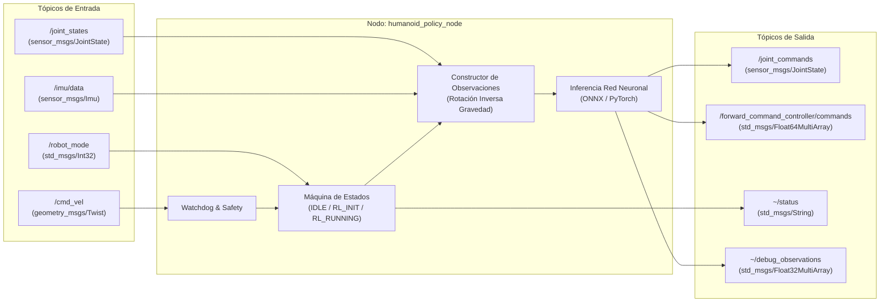

# ros2_policy_node.py

## Descripción General

El módulo `ros2_policy_node.py` implementa el nodo oficial de **ROS 2** para la ejecución en tiempo real de políticas de aprendizaje por refuerzo (RL) para el robot **ITESO Humanoid** / **Berkeley Humanoid Lite**.

A diferencia de los ejecutores monolíticos anteriores (que acoplaban la inferencia neuronal directamente a sockets UDP o controladores de hardware cerrados), este nodo opera bajo una arquitectura **modular y desacoplada**:
- Recibe la telemetría del robot a través de tópicos estándar de ROS 2 (`/joint_states`, `/imu/data`).
- Recibe comandos de marcha y velocidad desde `/cmd_vel` y control de estados desde `/robot_mode`.
- Ejecuta la inferencia de la red neuronal entrenada (ONNX o PyTorch) a una frecuencia estricta (ej. 25 Hz o 50 Hz).
- Publica las trayectorias y ángulos articulares objetivo calculados en `/joint_commands` (`sensor_msgs/msg/JointState`) y `/forward_command_controller/commands` (`std_msgs/msg/Float64MultiArray`).

---

## Arquitectura de Comunicaciones



---

## Máquina de Estados (`RobotMode`)

1. **`IDLE` (Modo 1):**
   - El robot mantiene la postura actual o amortiguamiento pasivo. La política no genera movimientos activos.
2. **`RL_INIT` (Modo 2):**
   - Incorporación suave (*Stand-up*). Interpola linealmente desde las posiciones articulares medidas actuales hasta la postura inicial por defecto (`default_joint_positions`) durante `init_duration` segundos (por defecto 2.0 s).
   - Al completarse la interpolación, conmuta automáticamente a `RL_RUNNING`.
3. **`RL_RUNNING` (Modo 3):**
   - Inferencia activa de la red neuronal a la frecuencia configurada (`policy_dt`).
   - Envío continuo de posiciones objetivo hacia los actuadores.

---

## Parámetros de ROS 2

| Parámetro | Tipo | Valor por Defecto | Descripción |
| :--- | :--- | :--- | :--- |
| `config` | `string` | `"biped_25hz.yaml"` | Archivo YAML de configuración dentro de `configs/policies/` |
| `policy_rate` | `double` | `0.0` | Frecuencia de control en Hz (`0.0` auto-detecta del archivo YAML) |
| `cmd_vel_topic` | `string` | `"/cmd_vel"` | Tópico de comandos de velocidad Twist |
| `mode_topic` | `string` | `"/robot_mode"` | Tópico para conmutar modos (1: IDLE, 2: INIT, 3: RUNNING) |
| `joint_states_topic` | `string` | `"/joint_states"` | Tópico de estados medidos del robot |
| `imu_topic` | `string` | `"/imu/data"` | Tópico de orientación y velocidad angular |
| `joint_commands_topic` | `string` | `"/joint_commands"` | Tópico de salida para comandos articulares (`JointState`) |
| `forward_commands_topic`| `string` | `"/forward_command_controller/commands"` | Tópico de salida tipo array para ros2_control |
| `watchdog_timeout` | `double` | `0.5` | Tiempo límite en segundos sin mensajes en `/cmd_vel` antes de frenar a cero |
| `sensor_timeout` | `double` | `1.0` | Tiempo límite sin datos de sensores antes de pasar a retención segura |
| `init_duration` | `double` | `2.0` | Duración en segundos de la interpolación de incorporación en `RL_INIT` |
| `auto_start_after_init`| `bool` | `true` | Si conmuta automáticamente a `RL_RUNNING` tras terminar `RL_INIT` |
| `publish_all_joints` | `bool` | `true` | Publicar todas las articulaciones del robot en `/joint_commands` |

---

## Servicios

- **`~/reset_policy` (`std_srvs/srv/Trigger`):**
  Limpia los búferes de observaciones históricas y resetea las acciones previas de la política de control.

---

## Comandos de Ejecución

### 1. Iniciar el Nodo de la Política
```bash
python3 src/scripts/run_ros2_policy.py --config biped_25hz.yaml
```
o mediante parámetros de ROS 2:
```bash
python3 src/scripts/run_ros2_policy.py --ros-args -p config:=humanoid_legs.yaml -p watchdog_timeout:=0.8
```

### 2. Probar en Simulación MuJoCo con ROS 2
En una terminal:
```bash
python3 src/scripts/sim/mujoco_ros2_sim.py --config biped_25hz.yaml
```
En otra terminal:
```bash
python3 src/scripts/run_ros2_policy.py --config biped_25hz.yaml
```

### 3. Activar el Modo de Marcha y Enviar Velocidad
```bash
# Cambiar a modo RL_INIT (incorporación)
ros2 topic pub /robot_mode std_msgs/msg/Int32 '{data: 2}' --once

# Enviar comando de velocidad hacia adelante
ros2 topic pub /cmd_vel geometry_msgs/msg/Twist '{linear: {x: 0.35}}' -r 10
```
